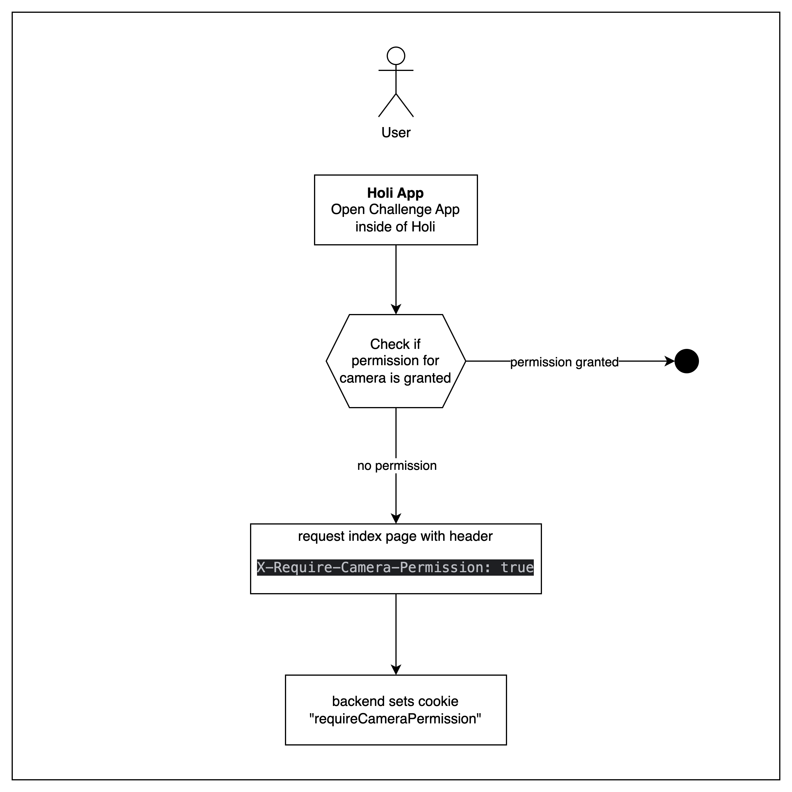
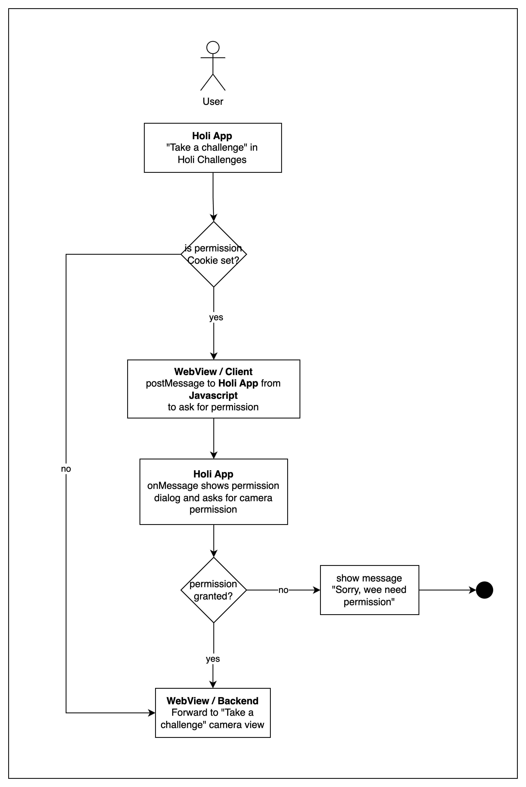

# Holi Challenge App 

## Prolog

Holi Challenges inspires you to be a social hero by starting with simple actions. Whether it’s choosing to bike instead of driving or enjoying a meat-free day, every little step counts. The journey is personal but shared collectively, as everyone in the community contributes their experiences.

Start now and become a part of the Holi Challenges family. Together, we're not just changing habits; we're changing the world.

## System overview

The Holi Challenge app operates independently as a vertical application, including both frontend and backend components hosted on a dedicated server. The Holi app primarily serves as a gateway, accessed via the App Drawer, which manages:

- Opening a webview to the challenge app's frontend.
- Handling camera permissions.
- Facilitating intent calls to open user profiles within the main Holi app.

## Authentication

Holi and Challenges uses the same [ORY](https://www.ory.sh/) project as a authentication. That means, authentication between both apps is seamless.

When the Challenge app is opened inside of Holi app, the ory session token will be passed to the backend. This is used to authenticate the user and create a auth-session for further interaction.

## Camera Permission

To participate in a challenge and submit your own video, permissions to access the camera are required. 

### iOS

For iOS this is straightforward. Permission are requested at the moment, when the camera opens and the user is asked to grant it. 
The webview propagates the permissions to the user.

### Android

On Android this is a little bit more tricky. Camera permissions need to be requested from inside the Holi app itself via expo.
This requires the Challenge app to post a message to the Holi app to ask for permission.

**User opens Challenge app**

When the user opens the challenge app, the expo framework checks if permission for camera are already set (`checkIfCameraPermissionIsRequired`).
The outcome of the check, will be sent in the index request to the Holi Challenge backend, which will set a session cookie (`requireCameraPermission`).
Once the camera opens, it will check for this cookie.

**Camera opens**

Once the user decides to take a challenge, he access the camera. Before the camera is opened, 
the backend checks, if a permission request cookie (`requireCameraPermission`) is set.

If the cookie is set to true and a camera request is required prior accessing the camera, 
a post message `requestPermission` is send to the Holi App from the Webview client.

In the method `requestPermissions()`, the user is asked to approve the camera permission and the
result is sent back to the Webview client.

If the permission is granted, the user is forwarded to the camera view. If not, a 
error message will be displayed.

    